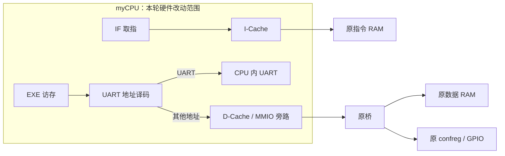

# I-Cache 与 D-Cache

本项目在 `myCPU` 内实现了独立的指令缓存和数据缓存，外部仍使用原有的一拍同步 SRAM 接口。SoC、桥、板级顶层、时钟和引脚约束保持提交 `10c225e` 的状态。

## 结构与策略

| 项目 | I-Cache | D-Cache |
| --- | --- | --- |
| 数据容量 | 1 KiB | 1 KiB |
| 组织 | 64 行，直接映射 | 64 行，直接映射 |
| 每行 | 16 字节，4 个 32 位字 | 16 字节，4 个 32 位字 |
| 读命中 | 不访问指令 RAM | 不访问数据 RAM |
| 读缺失 | 阻塞并顺序回填 4 个字 | 阻塞并顺序回填 4 个字 |
| 写策略 | 只读 | 写直达、写不分配，支持字节使能 |
| 复位 | 所有行失效 | 所有行失效 |

共享模块是 `mycpu_env/myCPU/cpu_sram_cache.v`。每行包含 valid、tag 和四个数据字；索引使用地址 `[9:4]`，字选择使用 `[3:2]`。缺失时先使被替换行失效，完整回填后再置 valid，因此中途取消不会留下部分新数据、部分旧数据的有效行。

D-Cache 写命中时按字节使能更新缓存，并向外部 RAM 写入一次；写未命中只写 RAM，不分配缓存行。这样不需要脏位和写回队列，外部 RAM 始终保持最新的已完成写入。



## 与现有硬件的接入

- `mycpu_top.v` 内实例化 `u_icache`、`u_dcache`，外部端口不变。`ICACHE_ENABLE`、`DCACHE_ENABLE` 默认均为 1，可以分别关闭。
- `IF_stage.v` 在缺失期间保持请求地址，只有完成后才产生取指有效信息。分支纠错、异常和 ERTN 会取消旧请求，并保留重定向目标直到新取指完成；分支取消经过寄存，避免重新把 ID 的组合分支判断接回外部 RAM 使能。
- `EXE_stage.v` 在数据缓存缺失时保留当前指令和地址，完成后才进入 MEM。请求有效信号不依赖 ready，避免组合环；原有异常、地址错和流水线清空对访存副作用的抑制继续有效。
- 缓存完成沿之后提供数据，保持 MEM 原有的一拍返回约定；不需要修改 MEM 总线宽度。
- GPIO、定时器和其他 confreg 地址全部旁路，判断与原桥一致：`(addr & 0x1FFF0000) == 0x1FAF0000`。CPU 私有 UART 仍在缓存前拦截，既不进入 D-Cache，也不向外部总线发送请求。

本 SoC 的指令 RAM 实际使用地址 `[19:2]`，数据 RAM 使用 `[17:2]`。缓存标签对应这些真实地址位，分别使用 20 位和 18 位地址空间，保证 `0x10000000`、`0x80000000`、`0xA0000000` 等映射到同一 RAM 单元的地址共用缓存数据，避免别名写入后读到旧值。

## 复现测试

在工程根目录运行，Python 和 Vivado 路径可按本机位置调整：

```powershell
$py = 'D:/Software/Vivado/2023.2/tps/win64/python-3.8.3/python.exe'
& $py tools/run_xsim.py cache
& $py tools/run_xsim.py if_cache
& $py tools/run_xsim.py cache_cpu
& $py tools/run_xsim.py cpu_branch --cache 1
& $py tools/run_xsim.py soc_uart --cache 1
& $py tools/run_xsim.py ex9 --cache 1
& $py tools/run_xsim.py ex9 --cache 1 --predictor 0
```

将 `--cache 1` 改为 `--cache 0` 可对照关闭 I/D 缓存的结果。`cache_cpu` 自带开关两组 CPU，会自动汇编 `software/cache_bench.S`，比较全部寄存器写回，并统计外部 RAM 请求；生成的镜像位于 build 中。

测试输出按预测和缓存配置分别保存。可用 `--build-root build/cache_20261027/behavioral` 指定位置；未指定时使用 `build/xsim/`。`tests/sim_models.sv` 是行为模型，真实 Xilinx IP 的验证证据另存于 `build/cache_20261027/`，两者的证明范围不同。

## 已验证的行为与结果

- 缓存单元测试：冷缺失、四字回填、同行命中、冲突替换、复位、字/半字/字节写入、写不分配、地址别名、MMIO 实时读取、取消部分回填以及关闭缓存。
- IF 定向测试：缺失时地址保持、预测跳转目标保持、ID 阻塞、分支取消、异常/ERTN 重定向及 ADEF。
- 整机汇编对照：两组 617 次寄存器写回完全相同；外部指令 RAM 读取为关闭/开启 `708/73`，数据 RAM 读取 `261/12`，MMIO 均读取 2 次。还检查 UART 私有访问和错误路径 store 不外发。
- CPU 分支基准继续比较预测开关两组的 51 次寄存器写回。
- 行为模型的 ex9 缓存开/关与预测开/关四组合全部通过 58 点和 Golden Trace，UART 缓存开/关两组也通过中断、回显和显示检查。
- 真实 Xilinx RAM/除法 IP 下，缓存开启时的 ex9 预测开/关均通过 58 点与 Golden Trace；两组 UART 均通过 6 帧、6 次 IRQ/ERTN、严格 ERA、23 次私有访问隔离及边界/CR0 探针。已核对全部 20 个硬件源文件与快照一致，并核对各项目实际 RAM 镜像。
- 原 SoC 接口的 Vivado RTL 层次检查通过。
- 缓存模块完整综合通过，两个配置均无错误、无关键警告、无锁存器。独立模块综合的 I-Cache 为 661 LUT、200 FF，D-Cache 为 781 LUT、199 FF，存储阵列使用分布式 RAM。这不是整机布局布线结果。

完整回归、真实 IP 及综合结果见 `lc.md` 最新缓存记录和 `build/cache_20261027/validation_summary.json`。

## 适用范围

这里实现的是针对当前物理分离指令/数据 BRAM 的缓存，后端必须是一拍同步 SRAM。CPU 原本没有实现的 CACOP、IBAR/DBAR、MMU 或 CSR 缓存属性，本次没有增加。当前 D 侧写入无法修改独立的指令 RAM，因此不声称提供自修改代码或外部 DMA 的一致性支持。

原后端 RAM 本来就只有一拍，冷缺失回填会增加周期；本次结果证明命中和外部访问量下降，不把该测试的访问量变化当作所有程序的执行加速。此前 UART 位流不含本次缓存；本次实现需要重新生成位流并通过整机时序和上板测试后，才能作为硬件验收结果。
